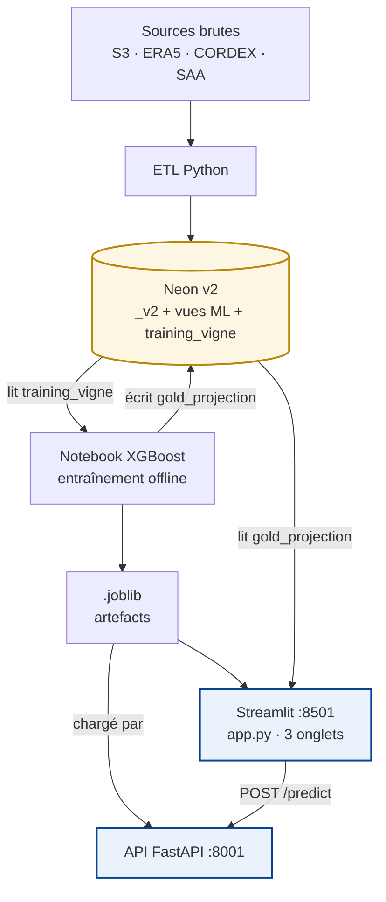

# 🌾 Harvest Games — Observatoire agricole du futur

**Où planter quoi dans le futur ?**

Harvest Games est un projet data d'aide à la décision destiné aux chambres
d'agriculture, collectivités et acteurs souhaitant comprendre les effets du
changement climatique sur l'agriculture française. L'application croise
données climatiques (ERA5, CORDEX), pédologiques, géographiques (RPG) et
agricoles (SAA) pour explorer l'évolution de la viabilité et du rendement
potentiel de cultures d'intérêt aux horizons **2054, 2084 et 2100**.

> ⚠️ **Avertissement** — Harvest Games est une preuve de concept pédagogique.
> Les résultats sont des estimations exploratoires fondées sur des données
> publiques et des modèles statistiques présentant plusieurs limites. Ils ne
> constituent pas des recommandations agronomiques opérationnelles.

---

## 🎯 Résumé

- **Modèle** : XGBoost départemental sur la vigne à raisin de cuve
- **Training set** : `training_vigne` — 1 134 lignes, 87 départements, 2010-2024
- **Performance** : R² = 0,37 / RMSE = 23,3 q/ha (split temporel 2021-2024)
- **Projections** : 255 lignes, 85 départements × 3 horizons (2054/2084/2100)
- **Interface** : Streamlit 3 onglets + API FastAPI séparée
- **Stack** : Python 3.13 · Neon (PostgreSQL/PostGIS) · AWS S3 · Docker

---

## À propos de ce dépôt (v2)

Ce dépôt est la **version 2** du projet. Il s'inscrit dans la continuité du
MVP initial (3 cultures, pipeline RandomForest par maille), disponible ici :
https://github.com/maussangceline-ops/HarvestGames, mais **approfondit
le pipeline Machine Learning sur la vigne à raisin de cuve** avec un modèle
XGBoost départemental exposé via une API FastAPI.

**Ce qui change par rapport au MVP :**

| Aspect | MVP | v2 |
|---|---|---|
| Cultures | Vigne + PDT + Pois chiche | Vigne approfondie + dataviz climatique multi-cultures |
| Modèle principal | RandomForest par maille | XGBoost départemental + Ridge comparatif |
| Interface | Streamlit monolithique | Streamlit unifié (3 onglets) + API FastAPI séparée |
| Base de données | Neon (v1) | Neon (v2 isolée, `_v2` suffixé) |
| Architecture ML | ML intégré à l'ETL | ML découplé (notebook → `.joblib` → API) |
| Structuration | — | Vues de compatibilité v1→v2 pour continuité |

Le MVP complet reste accessible dans le dépôt historique de l'équipe.

---

## Sommaire

1. [Problématique](#problématique)
2. [Objectifs](#objectifs)
3. [Architecture technique v2](#architecture-technique-v2)
4. [Résultats clés](#résultats-clés)
5. [Pipeline de données](#pipeline-de-données)
6. [Modélisation des données](#modélisation-des-données)
7. [Machine Learning](#machine-learning)
8. [Interface utilisateur](#interface-utilisateur)
9. [Données & conformité RGPD](#données--conformité-rgpd)
10. [Reproductibilité](#reproductibilité)
11. [Sources de données](#sources-de-données)
12. [Technologies](#technologies)
13. [Installation](#installation)
14. [Lancement](#lancement)
15. [Structure du dépôt](#structure-du-dépôt)
16. [Limites assumées](#limites-assumées)
17. [Équipe](#équipe)
18. [Licence](#licence)

---

## Problématique

Le changement climatique modifie progressivement les équilibres agricoles
français : hausse des températures moyennes, multiplication des épisodes de
chaleur extrême, évolution de la répartition des précipitations, déplacement
possible des zones favorables à certaines cultures, incertitude croissante sur
les rendements.

Harvest Games cherche à répondre à une question centrale :
**où planter quoi dans le futur ?**

L'objectif n'est pas uniquement d'identifier les zones menacées, mais aussi
de faire apparaître les territoires qui pourraient devenir favorables à de
nouvelles cultures.

---

## Objectifs

- Visualiser l'effet de la hausse des températures sur les cultures actuelles
- Croiser contraintes climatiques et caractéristiques des sols
- Repérer les zones maintenues, perdues ou nouvellement favorables
- Prédire un rendement agricole potentiel à partir de données historiques
- Comparer plusieurs scénarios climatiques (2054, 2084, 2100)
- Sensibiliser aux besoins d'adaptation de l'agriculture française

---

## Architecture technique v2



### Composants principaux

- **AWS S3 v2** — data lake organisé en architecture médaillon
  (raw → bronze → silver → gold)
- **ETL Python** — extraction, nettoyage, harmonisation, remaillage,
  chargement vers Neon
- **Neon PostgreSQL + PostGIS** — source de vérité, tables `_v2` isolées du MVP
- **Vues de compatibilité** — permettent à l'ancien code (interface MVP,
  scripts de prédiction) de fonctionner sans modification sur la nouvelle base
- **Notebook XGBoost** — entraînement du modèle départemental et projection
  des rendements 2054-2100 ; écrit `gold_projection_rendement_vigne` et les
  artefacts `.joblib`
- **API FastAPI** — expose le modèle pour la prédiction en direct (port 8001)
- **Streamlit** — interface unifiée à 3 onglets (port 8501)

**Note sur le découplage ML** : contrairement au MVP (où l'entraînement était
intégré à l'ETL), la v2 sépare strictement l'entraînement (batch, offline,
notebook versionné) de l'inférence (online, API). Ce choix permet de rejouer
l'entraînement sans retoucher le pipeline d'ingestion.

---

## Résultats clés

| Indicateur | Valeur |
|---|---|
| R² XGBoost (test 2021-2024) | **0,37** |
| RMSE XGBoost (test) | **23,3 q/ha** |
| Rendement national projeté 2054 | **58,0 q/ha** |
| Rendement national projeté 2084 | 56,9 q/ha *(creux dû au pic de précipitations)* |
| Rendement national projeté 2100 | 61,7 q/ha |
| Cas démonstratif 51 (Marne) 2084 | **-31 %** vs moyenne historique |

---

## Pipeline de données

### Flux géographique et agricole

- Décompression des archives GPKG
- Conversion et harmonisation des identifiants
- Attribution de chaque parcelle à sa maille CORDEX la plus proche
- Calcul des surfaces exactes (projection Lambert-93)
- Agrégation par maille et par département

### Flux climatique

- Récupération ERA5 (historique) et CORDEX (futur) via l'API Copernicus
- Nettoyage et réduction aux mois d'avril à octobre (saison végétative)
- Conversion des unités (K → °C, m → mm, J/m² → W/m²)
- Construction des variables température / précipitations / rayonnement

### Flux de performance

- Extraction des rendements SAA par département
- Normalisation des codes département (2A/2B, zéros initiaux)
- Construction de `training_vigne` (1 134 lignes, 87 départements)
- Entraînement XGBoost et projection CORDEX

### Audit et qualité des données (EDA)

L'exploration des scores d'aptitude du MVP (`eda/01_eda_scores_mvp.ipynb`) a
révélé une incohérence sur les seuils de précipitation de la vigne : la borne
absolue maximale était fixée à **1 200 mm/an**, entraînant un score de pluie
nul pour **9 261 mailles** pourtant situées dans des zones à précipitations
réalistes (médiane 1 362 mm). La borne a été réévaluée à **1 500 mm/an** sur
la base des référentiels EcoCrop (FAO), ce qui a fait remonter le score de
pluie moyen de **63,8 à 79,8**. L'EDA souligne également que la pondération
des sous-scores (60/20/20) reste une hypothèse à consolider agronomiquement.

### Chargement

Les tables préparées dans la couche Gold de S3 sont chargées dans Neon v2
sous forme de tables suffixées `_v2`. Des vues de compatibilité recréent les
noms v1 pour permettre à l'ancien code (MVP) de continuer à fonctionner.

---

## Modélisation des données

### Tables sources (`_v2`)

| Table | Rôle | Volume |
|---|---|---|
| `dim_constraints_v2` | Contraintes agroclimatiques par culture | 3 lignes |
| `dim_coordinates_v2` | Maillage CORDEX (lat/lon) | 8 825 mailles |
| `dim_soils_v2` | Sols, départements, régions | 8 825 lignes |
| `src_climate_past_v2` | ERA5 mensuel 2010-2024 | 1 588 500 lignes |
| `src_climate_future_v2` | CORDEX RCP 8.5 (2054, 2084, 2100) | 317 700 lignes |
| `src_cultures_plots_2024_v2` | Parcelles agricoles 2024 (géométries) | 660 123 lignes |
| `src_yields_cordex_2010_2025_v2` | Rendements dépt × culture × année | 185 100 lignes |

### Vues de compatibilité

Alias `nom_v1 → table _v2` permettant à l'ancien code de fonctionner sans
modification. Exemples :

- `dim_constraints` → `dim_constraints_v2`
- `src_climate_past` → `src_climate_past_v2`
- `src_yields_cordex_2010_2025` → redéfinie avec renommage
  `annee → year`, `surface_ha → surface_ha_12_5km`

### Vues ML (construction du training set)

- `climate_maille_vigne` — agrégation mensuelle avril-octobre par maille
- `sol_dept` — sol dominant par département (mode statistique)
- `maille_vigne` — jointure rendements × climat × sol par maille
- `training_vigne` — table d'entraînement finale (agrégation départementale
  pondérée par surface viticole)

---

## Machine Learning

### MVP (maille, multi-cultures) — RandomForest

Le MVP travaillait à l'échelle de la maille CORDEX (~12 km) sur trois
cultures, avec un RandomForest par culture.

**Variables** : température moyenne, précipitations cumulées, rayonnement
solaire, type de sol.

**Résultats (test 2023-2024 non vus)** :

| Culture | R² approximatif |
|---|---|
| Vigne | 0,08 |
| Pois chiche | 0,17 |
| Pomme de terre | 0,28 |

Les performances faibles s'expliquent par l'absence de variables explicatives
essentielles (irrigation, pratiques culturales, variétés, maladies, etc.).

### v2 — Modèle départemental vigne (XGBoost)

La v2 approfondit le cas de la **vigne à raisin de cuve** avec un modèle
départemental.

**Jeu d'entraînement** : `training_vigne` — 1 134 lignes (87 dépts × 2010-2024),
agrégation pondérée par surface viticole départementale.

**Features** : `temp_saison`, `precip_cumul`, `solar_moy`,
`soil_family_dominant`, `soil_type_dominant`, `year`, `code_departement`.

**Split temporel** : entraînement 2010-2020 (802 lignes), test 2021-2024
(332 lignes).

**Comparaison des modèles** :

| Modèle | R² test | RMSE (q/ha) |
|---|---|---|
| Baseline (moyenne départementale) | 0,47 | 21,4 |
| Ridge (linéaire régularisé) | **0,49** | **21,0** |
| XGBoost | 0,37 | 23,3 |

**Choix pour la projection : XGBoost.** Ridge est meilleur sur le test mais
**instable en extrapolation** (prédictions négatives par endroits sur
2054-2100). XGBoost, structurellement borné par les valeurs vues à
l'entraînement, reste dans une plage crédible (35-105 q/ha) sur les trois
horizons. Le critère de sélection n'est donc pas la performance pure sur le
test, mais la **robustesse en projection climatique**.

**Projections produites** (`gold_projection_rendement_vigne`) :
- 255 lignes — 85 départements × 3 horizons
- Trois valeurs par ligne : `rendement_bas`, `rendement_moyen`,
  `rendement_haut` (fourchette = prédiction ± RMSE du modèle sur le test)

**Résultats nationaux** :

| Horizon | Rendement moyen (q/ha) |
|---|---|
| 2054 | 58,0 |
| 2084 | 56,9 |
| 2100 | 61,7 |

**Analyse du creux 2084** : le pic de précipitations projetées (+40 % vs
2054/2100) provoque une baisse relative du rendement moyen. Ce n'est pas la
chaleur qui pénalise le modèle, mais l'excès d'eau — cohérent avec les
mécanismes agronomiques (pression fongique, dilution des maturités).

**Cas démonstratif** : le dépt 51 (Marne, Champagne) est projeté à **-31 %
en 2084** par rapport à sa moyenne historique, en raison d'un pic de
précipitations projeté à 770 mm.

---

## Interface utilisateur

Le Streamlit unifié comprend 3 onglets.

### 📊 Analyse climatique

Deux lectures complémentaires de l'effet climatique sur les cultures.

**Carte thermique (maille CORDEX, ~12 km)**

Héritage du MVP. Cartographie de l'exposition thermique des cultures historiques.

- Sélection de la culture (vigne, PDT, pois chiche)
- Trois modes : situation observée 2024, projection CORDEX 2054, simulation
  de hausse personnalisée
- Carte interactive des mailles classées viable / critique / fatale

**Carte de favorabilité agronomique (département)**

Carte expérimentale complémentaire, basée sur un **score agronomique
simplifié** sensible au slider de hausse de température.

- Score 0-100 : température (75 %) + sol dominant (25 %)
- Les précipitations sont volontairement exclues (impact non-linéaire,
  courbe en cloche)
- Objectif : visualiser la migration potentielle des zones favorables à
  chaque culture
- Complète le modèle XGBoost (qui ne peut pas extrapoler au-delà des
  conditions vues à l'entraînement)

### 🍇 Rendement vigne (ML)

Le pipeline ML vigne.

- **Filtre département** : graphique historique + projections filtrés par
  département ou sur la moyenne nationale
- **Courbe historique 2010-2024** : rendement annuel moyen
- **Courbe projections 2054/2084/2100** : rendement moyen avec fourchette
- **Simulateur en direct** : curseurs température / précipitations /
  rayonnement / sol, appel à l'API FastAPI, retour instantané

> Le simulateur signale automatiquement les valeurs hors plage
> d'entraînement — XGBoost ne peut pas extrapoler au-delà des conditions
> vues à l'entraînement (T° ∈ [10,8 ; 21,5] °C, P ∈ [92 ; 1120] mm).

### 🧠 À propos du modèle

Documentation pédagogique de la méthodologie, des sources et des limites.

---

## Données & conformité RGPD

**Aucune donnée personnelle n'est collectée, traitée ou stockée par
Harvest Games.**

| Point de conformité | Statut |
|---|---|
| Sources utilisées | Exclusivement publiques et ouvertes (SAA, ERA5, CORDEX, RPG, INRAE, IGN) |
| Données personnelles | Aucune — le RPG utilisé est la version publique anonymisée, sans identifiant d'exploitant |
| Cookies / tracking Streamlit | Aucun |
| Données d'usage (logs utilisateur) | Aucune collecte |
| Credentials (Neon, AWS, Copernicus) | Stockés dans `.env` **non versionné**, documentés par `.env.example` (valeurs factices) |
| Exposition des clés API | Jamais côté client — appels S3 et Copernicus exécutés dans les scripts ETL batch |
| Base de données Neon | Accessible uniquement via chaîne de connexion authentifiée |

---

## Reproductibilité

Le projet est conçu pour être rejouable à l'identique :

- **`requirements.lock.txt`** — versions exactes pinées de toutes les
  dépendances (généré via `pip freeze`), garantit qu'un
  `pip install -r requirements.lock.txt` reproduit l'environnement de
  développement à la version près
- **Notebook versionné** — `train/notebooks/train_vigne_xgboost.ipynb`
  contient le split temporel, l'entraînement et la génération des projections
- **Reconstruction SQL** — `ETL/utils/build_training_vigne.sql` permet de
  reconstruire `training_vigne` depuis les tables sources
- **Vues de compatibilité** — `ETL/utils/create_compat_views.py` + dump des
  anciennes vues dans `ETL/utils/dump_old_views/`
- **Artefacts ML** — les `.joblib` sont gitignorés mais régénérables en
  rejouant le notebook
- **Périmètre de rejouabilité** — L'étape `extract.py` dépend d'API tierces (Copernicus CDS)
  dont les politiques d'accès ont évolué depuis le développement du projet (été 2026).
  Certains jeux de données ont également été téléchargés manuellement depuis leurs portails respectifs.
  Pour cette raison, la reproduction du pipeline complet se fait à partir de `transform.py`,
  en utilisant les données brutes déjà consolidées sur le bucket S3 harvestgames-v2.
  Le notebook d'entraînement et les scripts SQL de reconstruction sont directement rejouables.
- **Notebook d'EDA (MVP)** — `eda/01_eda_scores_mvp.ipynb` documente l'audit
  des scores d'aptitude agroclimatique du MVP. Il consomme le fichier
  `scores_cultures_mailles_12km_2010_2025.csv` (disponible sur S3) et génère
  `scores_cultures_corrige.csv` (non versionné, régénérable).
  - **Diagnostic biais CORDEX** — `ETL/utils/calculate_bias.py` documente la méthode Delta
  explorée en MVP. Non intégré à la V2 en raison d'un double comptage du réchauffement
  identifié lors de l'audit (période de référence 1976-2005 vs ERA5 2010-2024).

---

## Sources de données

| Donnée | Source | Résolution |
|---|---|---|
| Rendements agricoles | Agreste / SAA 2010-2025 (provisoire) | Département × culture × année |
| Sols | Carte des sols agricoles de France | Maille 12,5 km |
| Climat passé | ERA5 (Copernicus) | Mensuel 0,25° |
| Climat futur | CORDEX RCP 8.5, CNRM-ALADIN63 | Mensuel 0,11° |
| Parcelles | Registre parcellaire graphique (IGN) | Parcelle 2024 |
| Limites administratives | IGN / data.gouv.fr | GeoJSON |

Liens directs :
- [CORDEX Copernicus](https://cds.climate.copernicus.eu/datasets/projections-cordex-domains-single-levels)
- [RPG](https://www.data.gouv.fr/datasets/rpg)
- [Carte des sols](https://entrepot.recherche.data.gouv.fr)
- [Rendements agricoles](https://www.data.gouv.fr/datasets/agreste-statistique-agricole-annuelle-saa)

Les fichiers raw sont volumineux et non versionnés. Ils sont disponibles
sur bucket S3 `harvestgames-v2` (configuré en lecture seule, aucune donnée personnelle).

---

## Technologies

**Langages et frameworks**
- Python 3.13, SQL
- Streamlit, FastAPI
- PostgreSQL + PostGIS

**Data et Machine Learning**
- pandas, numpy
- scikit-learn, XGBoost
- geopandas, shapely, rasterio
- xarray, netCDF4
- boto3 (S3), cdsapi (Copernicus)

**Infrastructure**
- AWS S3
- Neon PostgreSQL
- Docker / Docker Compose

**Visualisation**
- Plotly (cartes + graphiques)
- Streamlit

---

## Installation

### Prérequis

- Python 3.13
- Un compte [Neon](https://neon.tech) (PostgreSQL + PostGIS)
- Un bucket AWS S3 (nommé `harvestgames-v2`)
- Un compte [Copernicus CDS](https://cds.climate.copernicus.eu) (clé API)

### Cloner le dépôt

```bash
git clone https://github.com/hantoinen/HarvestGames_v2.git
cd HarvestGames_v2
```

### Installer les dépendances

```bash
python -m venv .venv
# Windows
.venv\Scripts\activate
# Linux/macOS
source .venv/bin/activate

# Reproduction exacte (recommandé)
pip install -r requirements.lock.txt
```

### Configurer l'environnement

```bash
cp .env.example .env
# Renseigner les valeurs : Neon, AWS, Copernicus
```

---

## Lancement

### En local (deux terminaux)

```bash
# Terminal 1 — API FastAPI
python streamlit/api.py
# → http://127.0.0.1:8001

# Terminal 2 — Interface Streamlit
streamlit run streamlit/app.py
# → http://localhost:8501
```

### Via Docker (UI uniquement)

```bash
docker-compose up --build
# → UI sur http://localhost:8501
# L'API doit être lancée en parallèle (terminal 1 ci-dessus)
```

> Le conteneur Docker embarque uniquement l'interface Streamlit.
> L'API FastAPI est lancée en parallèle en local (port 8001).

---

## Structure du dépôt

```
HarvestGames_v2/
├── eda/
│   └── 01_eda_scores_mvp.ipynb      # Analyse exploratoire (MVP)
├── ETL/                          # Pipeline d'ingestion
│   ├── utils/
│   │   ├── dump_old_views/       # Dump SQL des vues v1 (avant migration)
│   │   ├── build_training_vigne.sql
│   │   ├── calculate_bias.py     # Diagnostic biais CORDEX (méthode Delta MVP)
│   │   ├── create_compat_views.py
│   │   ├── dump_old_views.py
│   │   ├── extract.py
│   │   ├── load.py
│   │   └── transform.py
│   ├── README.md
│   └── requirements.txt
├── docs/
│   └── dictionnaire_donnees.md   # Description des tables et variables
├── models/                       # Artefacts ML (.joblib, gitignored, régénérables)
├── streamlit/                    # UI + API
│   ├── api.py                    # API FastAPI (port 8001)
│   ├── app.py                    # Application Streamlit 3 onglets
│   ├── Dockerfile
│   ├── requirements.txt
│   └── README.md
├── train/                        # Entraînement ML
│   ├── notebooks/
│   │   └── 02_train_vigne_xgboost.ipynb
│   ├── build_fact_crop_projection.py
│   ├── requirements.txt
│   └── README.md
├── .env.example
├── .gitignore
├── docker-compose.yml
├── requirements.lock.txt
├── requirements.txt
└── README.md
```

---

## Limites assumées

- **Extrapolation XGBoost** — le modèle ne peut pas extrapoler au-delà des
  plages vues à l'entraînement (T° ∈ [10,8 ; 21,5] °C, P ∈ [92 ; 1120] mm).
  Le simulateur signale les valeurs hors plage.
- **Effet terroir dominant** — le `code_departement` capture une part
  importante de la variance (appellation, pratiques locales, cépage). Le
  modèle apprend donc en partie une signature géographique, pas uniquement
  un effet climatique.
- **Écart CORDEX / ERA5** — l un écart moyen de ~0,9 °C a été diagnostiqué entre
  CORDEX historique et ERA5. Cet écart inclut le biais du modèle et le réchauffement
  entre les périodes (1976-2005 vs 2010-2024). Il n'a pas été corrigé pour éviter
  un double comptage (voir calculate_bias.py). Les projections en héritent.
- **R² modeste** — 0,37 en test. Cohérent avec l'absence de variables
  explicatives clés (irrigation, pratiques, variétés, maladies, etc.).
  Le modèle capture essentiellement l'effet terroir.
- **Vigne uniquement en v2** — l'approfondissement focalisé sur la vigne
  s'appuie sur l'existence du MVP multi-cultures en parallèle.
- **Pas de causalité** — le modèle apprend des corrélations historiques,
  pas des mécanismes agronomiques. Il ne remplace pas une expertise terrain.

---

## Équipe

| Membre | Rôle |
|---|---|
| **Antoine Nguyen** | Architecture, base de données, Machine Learning, API, Streamlit v2 |
| **Céline Maussang** | MVP : Streamlit initial, Machine Learning multi-cultures |

**Cohorte** : Jedha Bootcamp — Data Analyst Full Stack, `dafs-ft-20`
**Certification** : CDSD — Bloc 6

---

## Licence

Projet pédagogique réalisé avec Céline Maussang (dataviz) dans le cadre de la certification
CDSD (Jedha Data Analyst & Fullstack, RNCP35288). Aucune licence open-source n'est appliquée :
le code est publié à des fins de démonstration.

Les données sources restent soumises à leurs licences respectives
(Copernicus, IGN, INRAE, data.gouv.fr).